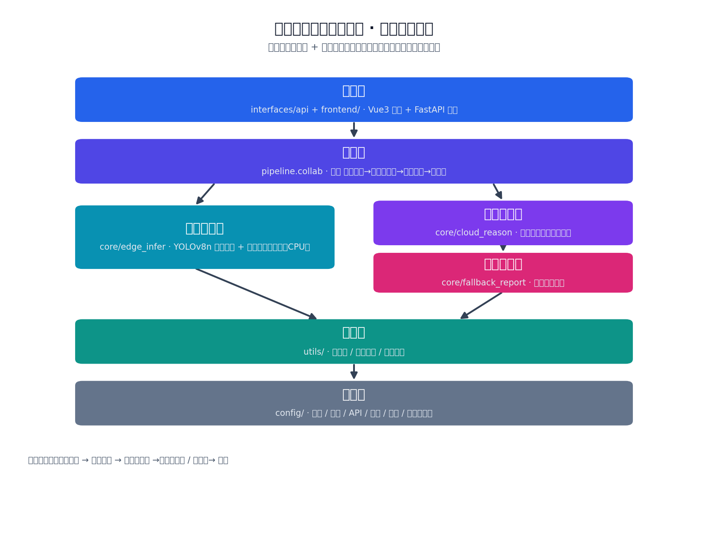
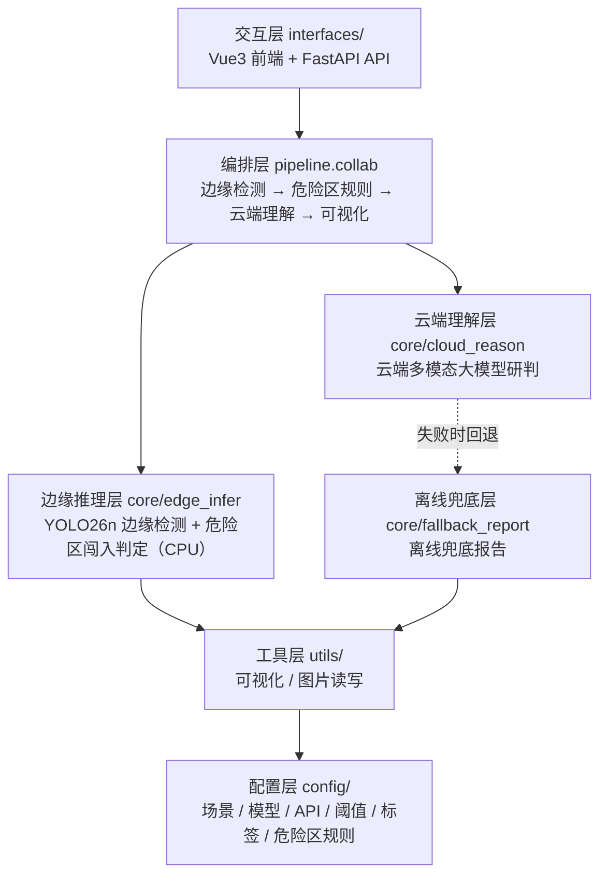

# 智慧工地安全巡检平台 · 端云协同 AI 推理应用（智算方向）

基于 **边缘端 YOLO26n 轻量推理 + 云端多模态大模型理解** 的跨域协同施工安全巡检原型，面向移动云 AI Coding 大赛「智算方向」（跨域协同 / 模型推理优化）。

本地边缘端只跑轻量检测（CPU 即可），并对"危险作业区"做实时规则化闯入预警；深度语义研判由云端大模型完成，二者协同构成"端云协同推理"。

---

## 一、场景定位：智慧工地安全巡检

把通用视觉推理**深耕到工地安全这一个垂直领域**，解决真实生产痛点：

- 边缘端实时识别**作业人员、工程运输车、通勤车辆**等要素；
- 画面中圈定一块**危险作业区**（如吊装/深基坑/临边区域），人员或车辆闯入即**实时标红预警**；
- 云端大模型把"看到的结果"写成可执行的**《施工安全巡检报告》**（现场概况 / 隐患研判 / 整改建议 / 处置结论）。

> 这正是智算方向倡导的"**跨域协同**"：边缘侧负责便宜、快速、隐私友好的感知，云端侧负责昂贵的深度语义理解，算力在端云之间合理分工。

---

## 二、总体架构（分层解耦 · 端云协同）



> 架构图由 `tools/generate_architecture.py` 生成（可复现）：`python tools/generate_architecture.py`



**核心设计思想：边缘感知与云端研判解耦。**
边缘端 YOLO 负责"看得准"（精确计数、画框、危险区规则），云端大模型负责"说得清"（语义理解、报告撰写），二者通过统一的 `detections` 数据结构衔接，可独立替换升级。

## 三、目录结构

```
edge_cloud_infer/
├── config/                 # 配置层
│   └── settings.py         # 场景 / 模型 / API / 阈值 / 标签映射 / 危险区规则
├── core/                   # 核心能力层
│   ├── edge_infer.py        # 边缘推理层：YOLO26n 本地检测 + 危险区闯入判定
│   ├── cloud_reason.py       # 云端理解层：云端多模态大模型研判
│   ├── monitor_service.py    # 监控服务层：摄像头调度 + 逐帧检测线程 + 截屏 + MJPEG 流
│   ├── db.py                # 数据层：SQLite（用户/会话/相册/照片，零依赖）
│   ├── auth.py              # 认证层：注册/登录/Token 会话/个人资料
│   ├── album.py             # 相册层：文件夹分类 + 照片管理
│   └── fallback_report.py    # 离线兜底层：本地兜底报告（无 Key 时）
├── utils/                  # 工具层
│   ├── visualize.py         # 检测框 / 危险区绘制
│   ├── camera.py            # 解耦摄像头管理（本地发现 / 网络流）
│   └── imgio.py             # 图片读写 / 临时文件
├── pipeline/               # 编排层
│   └── collab.py            # 统一巡检入口：边缘检测→危险区→云端理解→可视化
├── interfaces/             # 交互层
│   └── api.py              # FastAPI 后端（前后端分离主入口，端口 8000）
├── frontend/               # Vue3 前端（端口 5173）
├── tests/                  # 测试
│   └── test_smoke.py       # 冒烟测试
├── tools/                  # 工具脚本
│   └── generate_architecture.py  # 架构图生成
├── 参赛说明模板.md           # 比赛提交用
├── 提交指南.md              # git 提交/推送指引
├── requirements.txt
└── .env.example
```

## 四、各层职责

| 层 | 模块 | 职责 | 关键接口 |
|----|------|------|----------|
| 配置层 | `config/settings.py` | 场景、模型路径、置信度阈值、LLM 端点/密钥、中文标签、危险区规则 | 模块常量 |
| 边缘推理层 | `core/edge_infer.py` | 加载 **YOLO26n** 检测（NMS-free）；`check_danger_zone()` 判定危险区闯入（支持手动划定） | `infer()` / `check_danger_zone()` |
| 云端理解层 | `core/cloud_reason.py` | 推理结果+原图送大模型，生成四段式施工安全报告 | `generate_report()` |
| 离线兜底层 | `core/fallback_report.py` | 无 Key / 调用失败时生成离线兜底报告，保证服务高可用 | `build_fallback_report()` |
| 工具层 | `utils/` | 可视化（含危险区橙框）、图片读写、临时文件 | `draw_detections()` |
| 编排层 | `pipeline/collab.py` | 串联各层，对外暴露单一巡检入口 | `analyze_image()` |
| 交互层 | `interfaces/api.py` + `frontend/` | REST API + Vue3 网页：上传工地图→展示框图+危险区+报告 | `analyze_image()` / `/api/inspect` |

## 五、数据流

```
上传工地图片
  │
  ▼ utils.imgio.numpy_to_tempfile()         落盘为临时 jpg
  │
  ▼ core.edge_infer.infer()                 YOLO26n 边缘端检测 → detections（工地标签）
  │
  ▼ core.edge_infer.check_danger_zone()      危险作业区闯入判定 → intrusions
  │
  ├─► core.cloud_reason.generate_report()    推理结果 + 原图 → 云端大模型 → 《施工安全巡检报告》
  │      └─ 失败/无Key → core.fallback_report  离线兜底报告
  │
  ├─► utils.visualize.draw_detections()       原图 + 框 + 危险区 → 标注图（闯入标红）
  │
  ▼ 返回 (标注图路径, 报告文本, 概览) → 网页展示
```

## 六、运行步骤

1. 安装依赖：`pip install -r requirements.txt`
2. （可选）复制 `.env.example` 为 `.env` 并填入云端大模型密钥，启用云端研判：
   ```bash
   cp .env.example .env
   # 编辑 .env，填入 LLM_BASE_URL / LLM_API_KEY / LLM_MODEL
   ```
   不填也能跑 —— 会自动用本地兜底报告（离线兜底层）。
3. 启动（前后端分离）：
   ```bash
   ./run.sh -d                                   # 启动 FastAPI 后端（:8000）
   cd frontend && npm install && npm run dev     # 启动 Vue3 前端（:5173，需 Node 18+）
   ```
   浏览器访问 `http://localhost:5173`——首先进入**前导页**，注册/登录后即可使用全部功能。
   接口文档：`http://localhost:8000/docs`。
   生产模式：`cd frontend && npm run build` 后 FastAPI 自动托管 `dist/`，只跑后端一个进程，访问 `:8000` 即是完整应用。

> 首次运行会自动下载 `yolo26n.pt`（约 5.5MB）。

## 七、危险作业区（两种设定方式）

**① 手动划定（推荐，贴合真实生产）**：监控页摄像头开启后，点「⚠ 划定危险区域」→ 在画面上按住拖拽框选 → 松开自动保存。区域按用户存库（SQLite），后续检测/巡检/截屏全部按该区域判定闯入；「清除危险区域」恢复默认配置。

**② 配置文件默认区域**：`config/settings.py` 中：

```python
ENABLE_DANGER_ZONE = True                       # 是否启用危险区预警
DANGER_ZONE = (0.62, 0.12, 0.98, 0.62)          # 归一化矩形(x1,y1,x2,y2)
DANGER_ZONE_LABEL = "危险作业区"
ZONE_WATCH_CLASSES = {"person", "car", "truck", "bus", "motorcycle", "bicycle"}  # 受监管类别
```

标注图上危险区以**橙色框**标出，闯入目标以**红色框 + ⚠闯入**标出，巡检概览会给出"危险作业区闯入 N 起"的实时预警。

## 八、技术亮点（贴合智算方向）

- **跨域协同推理**：边缘端实时轻量检测 + 云端深度语义理解，分工协同，体现"跨域协同"。
- **模型推理优化**：边缘侧只用 YOLO26n 轻量模型（NMS-free 端到端，CPU），重算力集中在云端 API，整体推理成本可控。
- **规则化安全监管**：边缘端叠加"危险作业区闯入"规则，零延迟实时预警，不依赖云端。
- **检测与理解解耦**：YOLO 精确计数画框，多模态大模型负责语义理解与报告撰写，两层可独立升级。
- **零训练**：直接复用 YOLO26n 预训练权重，开箱即用。
- **高可用兜底**：无 Key 或云端调用失败自动降级到本地兜底，服务永不崩。

## 九、实时监控（解耦摄像头 + 截屏存证）

平台提供「🎥 实时监控」页，摄像头管理**与 UI 完全解耦**（`utils/camera.py`）：

- **搜索与选择**：点「🔍 搜索摄像头」自动发现本机摄像头；下拉框任选其一，做到"接哪个摄像头在前端选"。
- **手机 / 网络摄像头**：手机装 **IP Webcam / DroidCam** 后即变成一个网络视频流，把地址
  （`http://手机IP:8080/video` 或 `rtsp://...`）粘贴到「添加」即可被选中使用——电脑摄像头、
  手机摄像头、IP 监控统一成一份可选列表，真正做到解耦接入。
- **边缘端实时检测**：开启后逐帧本地运行 YOLO26n 并叠加危险作业区规则，检测框、闯入标红与实时告警同步刷新。
- **截屏存证**：
  - **主动截屏**：点「📸 主动截屏」保存当前帧并**标记问题**（检测框 + 危险区）；
  - **自动截屏**：检测到**危险作业区闯入**时系统自动存证（防抖限频），可在右侧画廊回看。
  - 截图保存在 `screenshots/`（已 gitignore，不入库）。
- **云端研判按需触发**：实时监控页专注边缘端 7×24 低成本盯防，仅在需要深度分析时才调云端，
  正是"端云协同 / 推理优化"的生产范式。

## 十、前后端分离架构（FastAPI + Vue3）

交互层采用**前后端分离**架构，核心推理/研判逻辑（`core/`、`pipeline/`、`utils/`）与 UI 完全解耦：

```
frontend/                      Vue3 + Vite + Element Plus（端口 5173）
  ├── src/api/index.js         后端 API 封装（axios）
  ├── src/views/InspectView    # 图片巡检页
  ├── src/views/MonitorView    # 实时监控页（MJPEG 流 + 轮询 + 画廊）
  └── src/views/HelpView       # 使用说明
interfaces/api.py              FastAPI 后端（端口 8000）
  ├── POST /api/inspect        图片巡检（上传 → 检测 → 危险区 → 云端报告）
  ├── GET  /api/cameras        搜索摄像头
  ├── POST /api/cameras/net    添加网络/手机摄像头
  ├── POST /api/monitor/start  开启监控
  ├── POST /api/monitor/stop   停止监控
  ├── GET  /api/monitor/stream MJPEG 实时视频流
  ├── GET  /api/monitor/state  实时状态轮询
  ├── POST /api/monitor/screenshot  主动截屏存证
  ├── GET  /api/monitor/report 云端研判报告
  └── GET  /api/screenshots/{name}  截图文件读取
core/monitor_service.py        监控服务层（与 UI 无关的服务：
                               摄像头调度、逐帧检测线程、状态维护、截屏、MJPEG 流）
```

**关键设计**：监控逻辑（摄像头 + 检测线程 + 截屏）被抽取为与 UI 无关的 `core/monitor_service.py`，
接口层只做 HTTP 协议适配，不掺和业务逻辑；前端可独立替换（Vue/大屏/其他客户端均可对接同一套 API）。

## 十一、账号 · 相册 · 个人中心

- **前导页**（`frontend/src/views/LandingView.vue`）：未登录访问即进入，含产品介绍与登录/注册卡片（标签页切换）。
- **认证**（`core/auth.py`）：PBKDF2 密码哈希 + 随机 Token 会话，数据存 SQLite（`data/app.db`，已 gitignore），零第三方依赖。
- **相册**（`core/album.py` + `AlbumView.vue`）：
  - 文件夹分类：新建 / 删除（级联删照片），卡片展示封面与张数；
  - 照片管理：上传、网格查看（ Element Plus 灯箱预览）、单张删除；
  - **监控截图自动入库**：实时监控页「主动截屏」时，已登录用户的截图会同步收入默认相册「巡检截图」。
- **个人中心**（`ProfileView.vue`）：修改昵称、个性签名、主题色（实时全站生效）、上传头像。

## 十二、可扩展点（框架预留）

| 扩展方向 | 改动位置 |
|----------|----------|
| 接入专用模型（安全帽/反光衣检测） | 替换 `config.DETECTION_MODEL` 为工地专用权重 |
| 多摄像头同屏 / 轮巡 | 在 `utils/camera.py` 支持多路 `CameraManager`，网页加布局 |
| 支持短视频：按帧采样 + 时序汇总 | 新增 `pipeline/video.py` |
| 增加 API 接口供大屏调用 | ✅ 已实现：`interfaces/api.py`（FastAPI，`/api/*`），大屏/第三方系统可直接对接 |
| 缓存 / 批处理加速 | `pipeline/collab.py` 中加入缓存与批量推理 |
